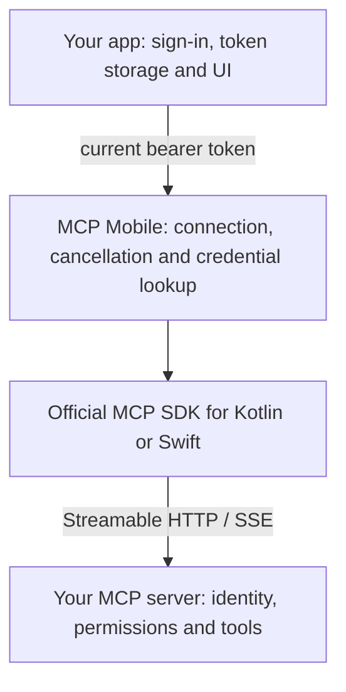

## How it fits

## Install

  <a class="home-path" href="./android/">
    <strong>Android</strong>
    Add the release repository bundle as a local Maven repository, then use the Kotlin or Java client.
  </a>
  <a class="home-path" href="./ios/">
    <strong>iOS</strong>
    Add the Swift package at version 0.1.0 and select the <code>MCPMobile</code> product.
  </a>
  <a class="home-path" href="./api/">
    <strong>API guide</strong>
    Client signatures for Kotlin, Java and Swift, and the lifecycle rules.
  </a>
  <a class="home-path" href="./publishing/">
    <strong>Publishing</strong>
    How releases, Maven distribution and Swift Package Manager work.
  </a>

